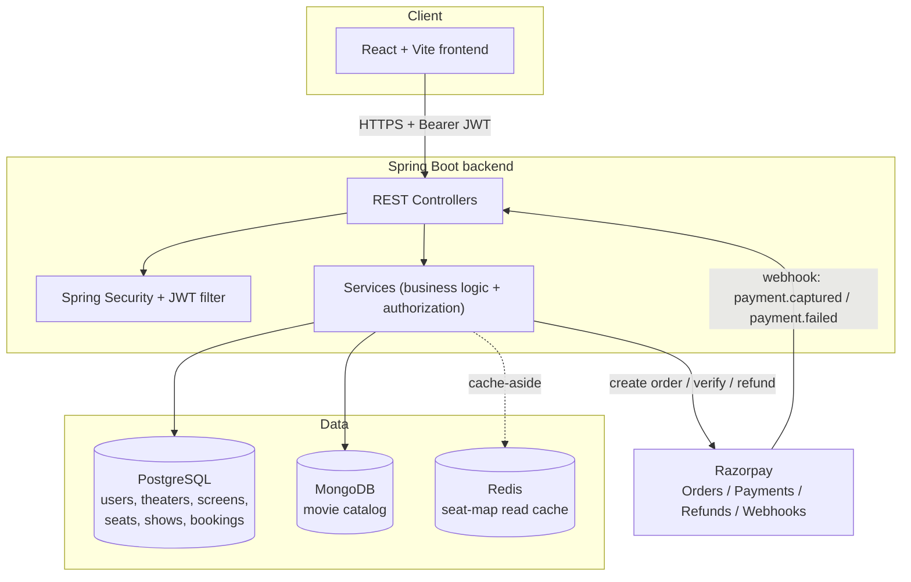
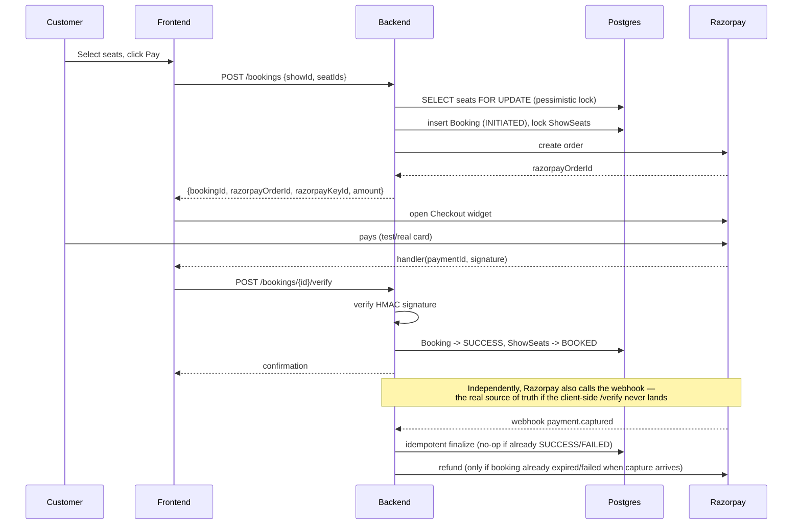
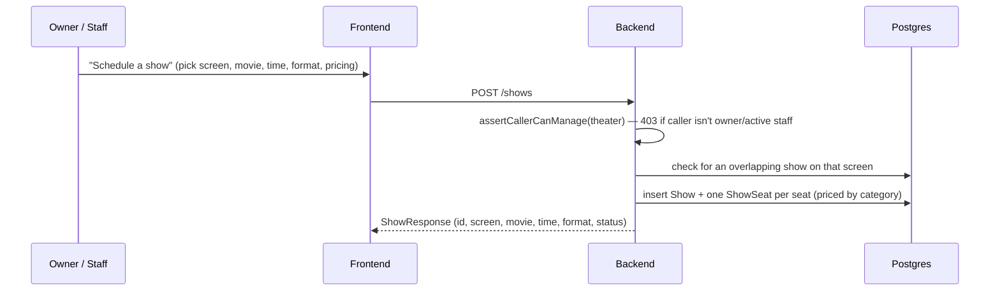
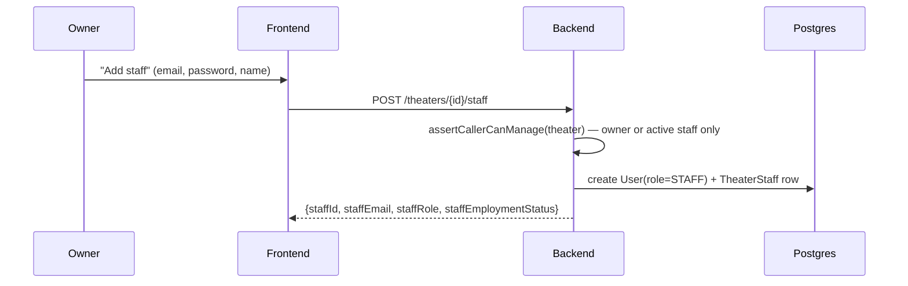
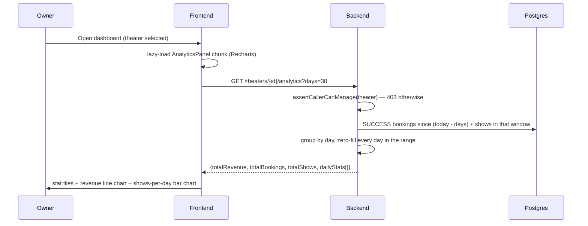

# Showtime — Architecture & Flow

Living doc covering the booking/payment, staff-management, show-scheduling,
and analytics work. See `frontend/CLAUDE.md` and `frontend/BACKEND_CONTRACT.md`
for frontend-specific conventions and the full API contract.

## System overview

**Roles:** `ADMIN` (provisions Owners) → `OWNER` (manages theater(s), staff,
shows, sees analytics) → `STAFF` (same screen/seat/show access as Owner,
scoped to the theater they work at) → `CUSTOMER` (books seats).

**Data split:** Postgres holds everything relational and transactional
(users, theaters, screens, seats, shows, bookings). MongoDB holds the movie
catalog (synced from TMDB). Redis is a *read-side cache only* — it never
holds the source of truth for seat locks or booking state; Postgres does.

---

## Flow 1 — Booking + Razorpay payment

**Why a Postgres row lock, not Redis, for the seat lock itself:** two
customers hitting "pay" for the same seat at the same instant must never
both succeed — that's a correctness guarantee, and only the transactional
database can give it. Redis TTLs are fast but not transactional against
Postgres, and Redis keyspace-expiry notifications are at-most-once and can
be missed, so relying on Redis for *locking* would let double-booking slip
through, not prevent it.

**Why Redis is used anyway:** the seat-map *read* endpoint (`GET /shows/{id}/seats`)
gets hammered by everyone browsing a show while one person is mid-checkout.
That's cached (5s TTL, evicted on every lock/book/release) purely to take
load off Postgres — if the cache is stale or Redis is briefly down, the
code falls back to a normal DB read, so it can never cause a wrong booking.

**Why a scheduled reaper, not just the client callback:** a customer who
opens checkout and simply closes the tab never calls `/verify` and Razorpay
never fires a webhook (no payment was attempted), so nothing would ever
release those seats. A `@Scheduled` job runs every 30s, finds `INITIATED`
bookings past their 10-minute hold, and releases the seats.

**Why auto-refund on a stale capture:** if a payment *does* land after the
hold already expired (rare, but possible under network delay), the seats
may already belong to someone else — the booking can't be honored. Rather
than silently keeping the customer's money, the webhook handler issues a
full Razorpay refund and records it (`razorpayRefundId`) for traceability.

---

## Flow 2 — Scheduling a show (Owner/Staff)

**Why the screen is picked *inside* the form now, not by drilling into a
screen first:** the original placement nested "Schedule a show" three
levels deep (dashboard → pick theater → open a screen → scroll down). Since
the screen is just one of the show's attributes, it belongs as a dropdown
in the create-show form itself — the "Shows" panel now lives directly on
the dashboard, one click away.

**Why this needed a backend fix, not just a frontend one:** `ShowService`
had no authorization check at all — any logged-in user (including a plain
Customer) could schedule a show on any theater's screen. Added the same
`assertCallerCanManage` guard already used by screen/seat creation.

---

## Flow 3 — Owner adds staff

The new staff account logs in and lands on a real Staff dashboard showing
the same theater identity, screens, and shows management as the Owner sees
— `assertCallerCanManage` already treated STAFF and OWNER equivalently on
the backend; the frontend just never had a Staff dashboard built for it
until now (`TheaterScreensView` is shared between both roles).

---

## Flow 4 — Owner analytics

**Key decisions:** revenue counts only `SUCCESS` bookings (money actually
collected, not abandoned/failed attempts); default window is 30 days with a
7/30/90 toggle; charting uses Recharts (added as a dependency) rather than
hand-rolled SVG, since the extra weight is real charts for one dependency
versus hand-maintained chart code. That weight is isolated: `AnalyticsPanel`
is `React.lazy()`-loaded, so its ~108KB gzip only downloads for an Owner who
actually opens the panel — every other role's bundle is unaffected.

---

## Known limitations (not silently glossed over)

- **No show-discovery UI.** There's no "browse shows by movie/city" yet —
  customers reach a show's booking page by direct link
  (`/shows/:id/book`) or by typing a show id on `CustomerDashboard`. The
  Owner/Staff "Shows" list is the only place a show's id is currently shown.
- **Abandoning checkout mid-payment** (closing the Razorpay popup) leaves
  the booking `INITIATED` and its seats `LOCKED` until the 30s reaper's
  10-minute window elapses — there's no immediate "cancel booking" endpoint.
- **Per-screen/theater show listings resolve each show's movie title with
  one MongoDB lookup per row** (N+1) — fine at expected per-theater show
  volumes, would need a batch-fetch if that list ever gets large.
- **No automated tests were added** for any of the booking, staff, show, or
  analytics endpoints/components built in this pass.
