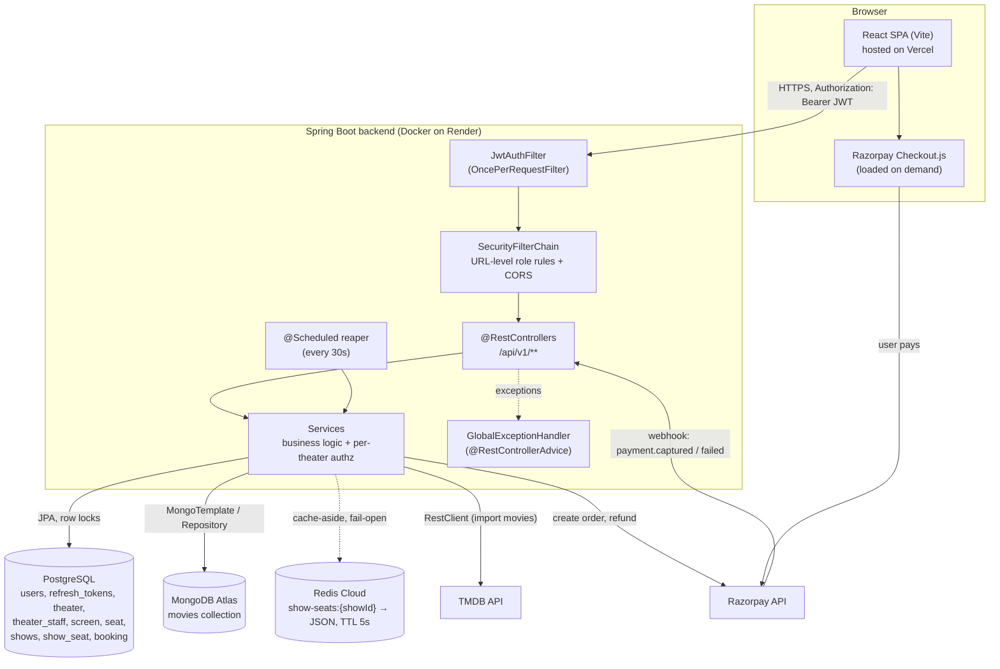
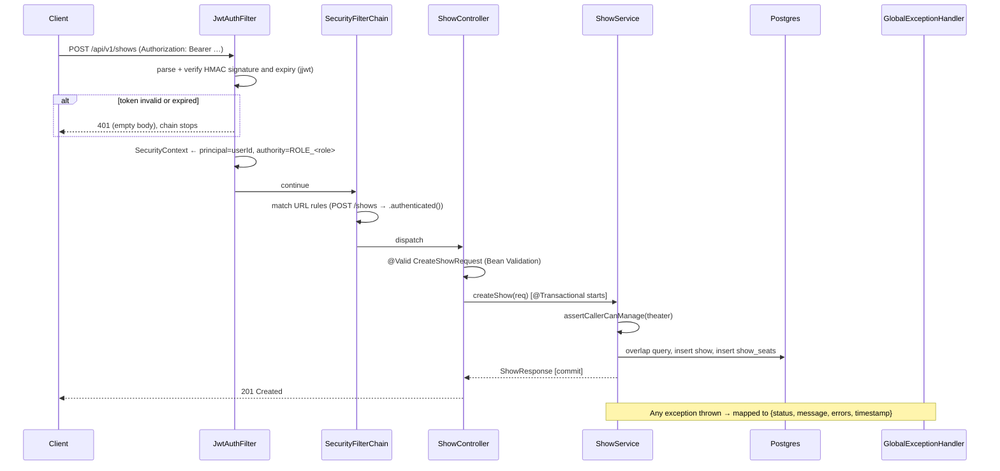
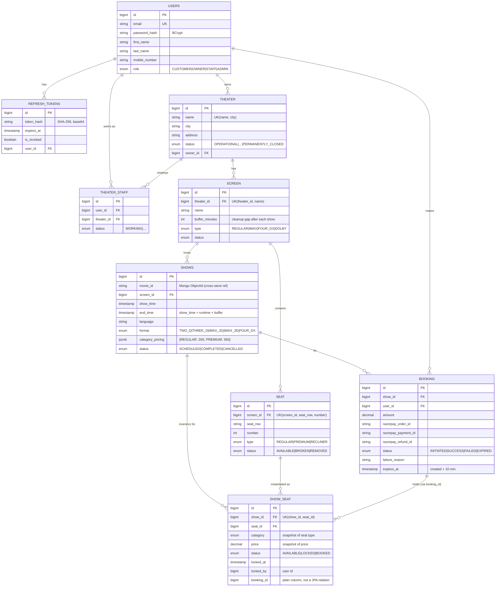
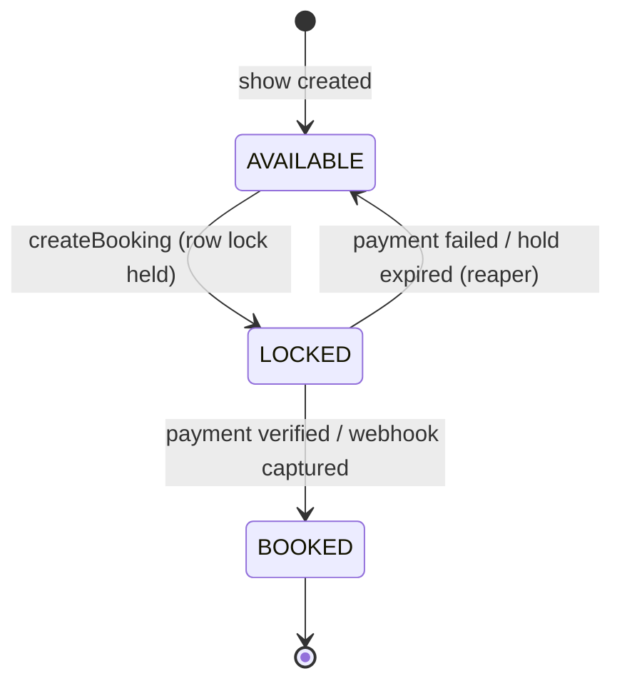
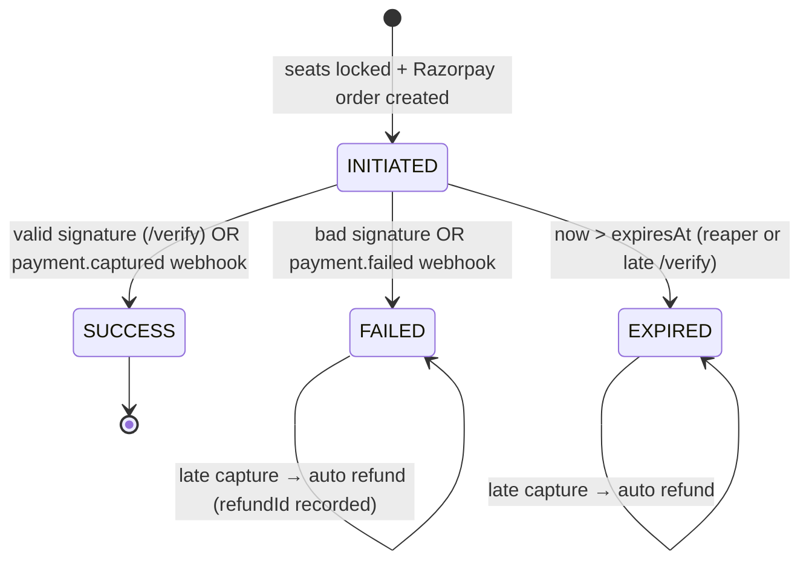
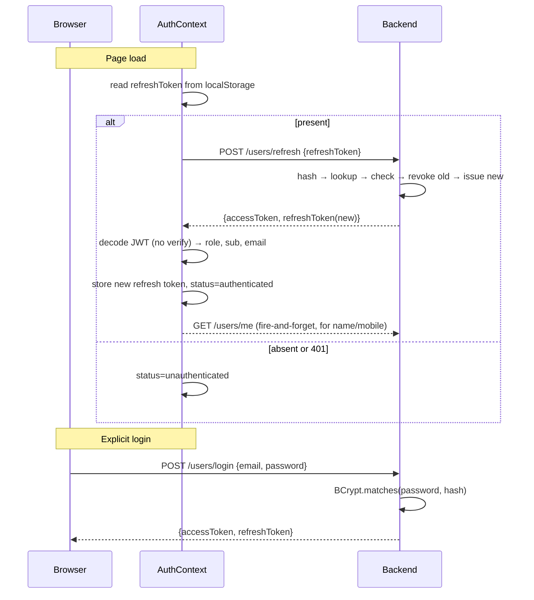
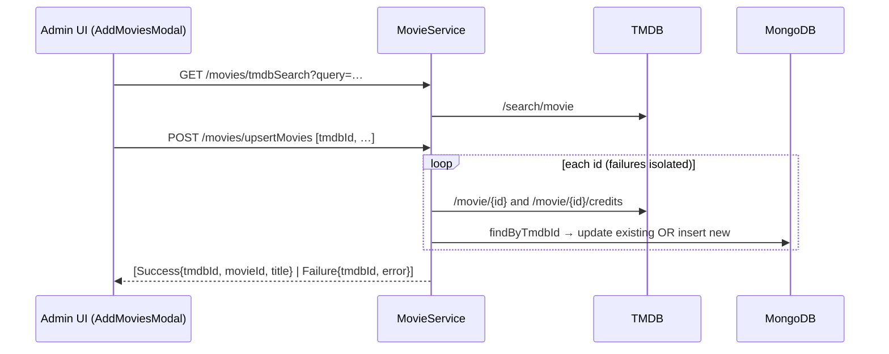
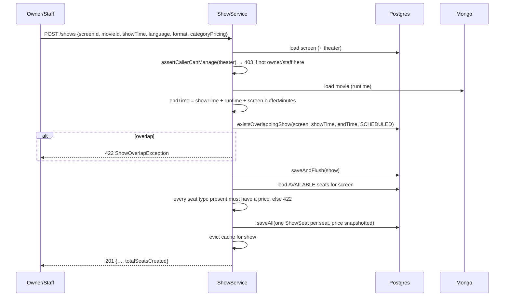
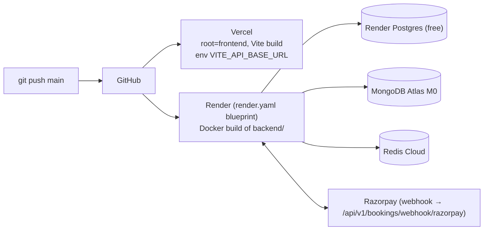

# Showtime — Architecture, Design Decisions & Interview Guide

A complete reference for how Showtime works end to end: what each part does,
how a request moves through the system, why each design decision was made,
where the weak spots are, and how to talk about all of it in an interview.

> **How to use this doc**
> - **Before an interview:** read §1 (pitch), §9 (concurrency), §10 (caching),
>   §15 (known gaps), and §17 (Q&A bank). That covers about 80% of the questions you'll get.
> - **To look up a detail:** use the table of contents. Every claim here points
>   to a real file in the repo, so you can open the code if someone asks for it.

---

## Table of contents

1. [The pitch (30 seconds and 2 minutes)](#1-the-pitch)
2. [Tech stack and why each piece was chosen](#2-tech-stack-and-why)
3. [System architecture](#3-system-architecture)
4. [Repository and code layout](#4-repository-and-code-layout)
5. [Request lifecycle (what happens on every API call)](#5-request-lifecycle)
6. [Data model](#6-data-model)
7. [Authentication and authorization](#7-authentication-and-authorization)
8. [Core business flows](#8-core-business-flows)
9. [Concurrency deep dive: preventing double booking](#9-concurrency-deep-dive)
10. [Caching deep dive: Redis seat-map cache](#10-caching-deep-dive)
11. [Payments deep dive: Razorpay](#11-payments-deep-dive)
12. [Frontend architecture](#12-frontend-architecture)
13. [API reference](#13-api-reference)
14. [Error handling contract](#14-error-handling-contract)
15. [Known gaps and tech debt (and how I'd fix each)](#15-known-gaps-and-tech-debt)
16. [Scaling: what changes at 10x and 100x](#16-scaling-discussion)
17. [Interview Q&A bank](#17-interview-qa-bank)
18. [Deployment and configuration](#18-deployment-and-configuration)
19. [Cheat sheet: numbers and names to remember](#19-cheat-sheet)

---

## 1. The pitch

### 30-second version

> Showtime is a full-stack movie ticket booking platform, similar to BookMyShow.
> Theater owners set up screens with custom seat layouts and schedule shows.
> Customers pick seats on a live seat map and pay through Razorpay. The hard
> part was making sure two people can never book the same seat. I solved it
> with Postgres row-level locks, a timed seat hold that a scheduled job cleans
> up, and webhook-based payment confirmation that is safe to receive twice and
> refunds automatically when a payment arrives too late. It's Spring Boot and
> React, with Postgres, MongoDB and Redis, deployed on Render and Vercel.

### 2-minute version (add these points)

- **Four roles** (Admin, Owner, Staff, Customer), each with its own dashboard.
  Authorization works in two layers: coarse URL rules in Spring Security, then
  fine-grained "do you own or work at *this* theater?" checks in the service layer.
- **Polyglot persistence.** Postgres holds transactional data (bookings, seats,
  shows). MongoDB holds the movie catalog imported from TMDB, because that data
  is document-shaped (nested cast lists, genre arrays) and read-heavy. Redis is
  a short-lived cache in front of the busiest read endpoint.
- **Payment correctness.** The client-side `/verify` call gives the user fast
  feedback, but the Razorpay webhook is the source of truth. Both paths
  converge on the same state transitions, so it doesn't matter which arrives
  first, or whether both arrive.
- **Auth.** Short-lived JWT access tokens (1 hour) plus opaque refresh tokens
  (14 days) that are stored hashed (SHA-256) and rotated on every use.
- **Analytics.** Owners get a revenue and bookings dashboard (Recharts), and
  that chunk is lazy-loaded so other roles never download it.

---

## 2. Tech stack and why

| Layer | Technology | Why this choice |
|---|---|---|
| Backend framework | **Spring Boot 4 (Java 21)** | Mature ecosystem for transactions, security and data access. Declarative `@Transactional` and `@Lock` make the locking strategy readable. |
| Web | Spring Web MVC | Blocking, thread-per-request model. It fits JDBC and pessimistic locks well; a reactive stack adds nothing here. |
| Security | Spring Security + **jjwt 0.12** | Stateless JWT auth; filter-chain integration; `@PreAuthorize` for method-level role checks. |
| Relational DB | **PostgreSQL** | ACID transactions and `SELECT … FOR UPDATE` row locks, which the seat-locking design depends on. Also `jsonb` for per-show pricing. |
| ORM | Spring Data JPA / Hibernate | Derived queries (`findAllByShow_Screen_Theater_IdAndStatus…`), JPQL, `@Lock(PESSIMISTIC_WRITE)`, auditing (`@CreatedDate`). |
| Document DB | **MongoDB** (Spring Data MongoDB) | The movie catalog is nested, schema-flexible TMDB data (cast arrays, genres). It's read-mostly and doesn't join with transactional tables. |
| Cache | **Redis** (Lettuce client, `RedisTemplate<String,String>`) | Fast TTL-based cache for the seat-map read path. |
| Mapping | **MapStruct** | Compile-time DTO↔entity mapping (`UserMapper`, `TmdbMovieMapper`). No reflection at runtime, and with `unmappedTargetPolicy = ERROR` a missed field fails the build. |
| Boilerplate | Lombok | Getters, setters and constructor injection via `@RequiredArgsConstructor`. |
| HTTP client | Spring `RestClient` | Calls TMDB, with connect and read timeouts configured (5s / 10s). |
| Payments | **Razorpay Java SDK** | Order creation, signature verification, refunds, webhooks. Standard choice for INR payments. |
| Frontend | **React 19 + Vite**, plain JS | Fast dev server; `React.lazy` code-splitting. |
| Styling | Tailwind CSS v4 | CSS-first config; design tokens live in `src/index.css` under `@theme`. |
| Routing | react-router-dom v7 | `BrowserRouter` plus a `ProtectedRoute` wrapper for role gating. |
| Charts | Recharts | Owner analytics, lazy-loaded. |
| Deploy | Docker (multi-stage), Render, Vercel, MongoDB Atlas, Redis Cloud | Free tiers; `render.yaml` blueprint for infrastructure as code. |

---

## 3. System architecture



**Architectural style:** a **modular monolith**. There is one deployable Spring
Boot app, internally organized *package-by-feature* (`booking`, `show`,
`showSeat`, `theater`, and so on). Each feature package owns its entity,
repository, service, controller, DTOs and exceptions. Features talk to each
other through **services, never another feature's repository**. For example,
`BookingService` calls `ShowSeatService.lockAvailableSeats(...)`; it does not
touch `ShowSeatRepository` directly. That boundary is what would make it
possible to extract a microservice later.

**Why not microservices?** One developer and one database, and the booking flow
needs a single ACID transaction across `booking` and `show_seat`. Splitting
those into services would turn a local transaction into a distributed saga for
no benefit at this scale.

---

## 4. Repository and code layout

```
Showtime/
├── ARCHITECTURE.md          ← this file
├── README.md                project overview + run locally
├── DEPLOYMENT.md            Render + Vercel + Atlas walkthrough
├── render.yaml              Render blueprint (Postgres + Docker web service)
├── backend/
│   ├── Dockerfile           multi-stage: JDK build → JRE runtime
│   ├── pom.xml              Spring Boot 4.0.6, Java 21, MapStruct, jjwt, razorpay-java, JaCoCo
│   ├── lombok.config        copies @Lazy onto generated constructors (see §15)
│   └── src/main/java/com/showtime/
│       ├── ShowtimeApplication.java   @EnableScheduling, @EnableAsync
│       ├── common/
│       │   ├── config/      SecurityConfig, RedisConfig, EncoderConfig (BCrypt), JpaAuditingConfig, SecurityPaths
│       │   ├── jwt/         JwtService (sign/parse), JwtAuthFilter
│       │   └── exception/   abstract base exceptions + GlobalExceptionHandler + ErrorResponse
│       ├── user/            register, login, refresh, logout, /me
│       ├── refreshtoken/    RefreshToken entity + rotation logic
│       ├── admin/           create Owner (+ their first theater), search theaters
│       ├── theater/         Theater entity, listing, "my theaters", JPA Specifications search
│       ├── theaterstaff/    TheaterStaff link table, add staff, assertCallerCanManage()
│       ├── screen/          Screen entity, row-segment seat layout creation
│       ├── seat/            physical Seat entity (row, number, type, status)
│       ├── movie/           Mongo Movie document, TMDB client + MapStruct mapper
│       ├── show/            Show entity, scheduling, overlap detection, jsonb pricing
│       ├── showSeat/        per-show seat inventory, locking, Redis cache
│       ├── booking/         Booking entity, Razorpay gateway, webhook, reaper
│       └── analytics/       per-theater revenue/bookings/shows time series
└── frontend/
    ├── vercel.json          SPA rewrite: every path → index.html
    └── src/
        ├── main.jsx         BrowserRouter + AuthProvider
        ├── App.jsx          route table with ProtectedRoute
        ├── api/             one module per backend resource; all go through client.js
        ├── context/         AuthContext (tokens, role, session restore)
        ├── lib/             jwt decode, Razorpay loader, role→path map, validators, formatters
        ├── pages/           Home, Login, Register, Admin/Owner/Staff/Customer dashboards, BookShow, Profile
        └── components/      SeatGrid, BookingSeatGrid, ScreenLayoutBuilder, CreateShowModal, AnalyticsPanel, …
```

**Layering inside each feature:**
`Controller` (HTTP shape, `@Valid`, status codes) → `Service` (transactions,
business rules, authorization) → `Repository` (Spring Data). Controllers are
thin; every rule lives in the service.

---

## 5. Request lifecycle

What happens when the frontend calls `POST /api/v1/shows` with a Bearer token:



Key points:

- **Stateless.** No HTTP session. The principal is just the user id (`String`)
  taken from the JWT `sub` claim; services read it with
  `SecurityContextHolder.getContext().getAuthentication().getPrincipal()`.
- **No token means anonymous, not rejected.** If the header is missing, the
  filter passes the request through and the URL rules decide. A *bad* token
  gets a 401 immediately.
- **`spring.jpa.open-in-view=false`.** Lazy associations must be loaded inside
  the service transaction. This avoids the anti-pattern of running DB queries
  during JSON serialization.

---

## 6. Data model

### 6.1 PostgreSQL (relational, transactional)



**Modeling decisions to be ready to defend:**

| Decision | Reasoning |
|---|---|
| **`Seat` vs `ShowSeat` split** | `Seat` is the physical chair and doesn't change between shows. `ShowSeat` is the sellable inventory for *one show*: its status, price and lock. Booking state can't live on `Seat`, because the same chair is sold separately for every show. This is the classic "template vs instance" pattern. |
| **Price and category snapshotted onto `ShowSeat`** | If the owner later reclassifies a seat or changes pricing, existing shows and bookings keep the price that was advertised. Totals are computed from `ShowSeat.price`, never from the request, so a client can't send its own price. |
| **`category_pricing` as `jsonb`** | Pricing is a small map keyed by seat type and always read whole. A separate `show_pricing` table would add a join for no query benefit. A custom `AttributeConverter` plus `@JdbcTypeCode(SqlTypes.JSON)` binds it correctly as jsonb (a recent fix; see commit `afc366a`). |
| **`end_time` stored, not computed** | Makes the overlap check a simple indexed range comparison: `existing.start < new.end AND new.start < existing.end`. |
| **`buffer_minutes` per screen** | Cleaning and ad time differ by screen. It's added to the movie runtime when computing `end_time`. |
| **Soft delete via status** (`PERMANENTLY_CLOSED`, `REMOVED`) | Historical shows and bookings still reference these rows. A hard delete would break foreign keys and analytics. |
| **Unique constraints in the DB** (`uk_show_seat_show_seat`, `uk_seat_screen_row_number`, `uk_screen_theater_name`, `uk_theater_name_city`) | App-level "exists?" checks are racy. The DB constraint is the real guarantee, and `DataIntegrityViolationException` is mapped to 409. |
| **`BigDecimal` for money** | No floating-point rounding. Converted to paise with `HALF_UP` and `longValueExact()` before sending to Razorpay. |
| **`Instant` for audit timestamps, `LocalDateTime` for show times** | Audit times are absolute moments. Show times are wall-clock times local to the theater. |
| **`ShowSeat.bookingId` is a plain `Long`, not `@ManyToOne`** | Keeps the lock and booking linkage simple and avoids cascade surprises. The trade-off is that Hibernate doesn't know about the dependency for insert ordering, which is why `ShowService` uses `saveAndFlush` (see §8.4). |

### 6.2 MongoDB (`movies` collection)

```json
{
  "_id": "665f…",                 // movieId, referenced by shows.movie_id
  "tmdbId": "550",                // unique index → makes import idempotent (upsert)
  "title": "Fight Club",
  "duration": 139,                // minutes, from TMDB runtime
  "genre": ["Drama", "Thriller"],
  "cast": [{ "name": "…", "character": "…", "order": 0 }],
  "posterPath": "/…jpg",
  "backdropPath": "/…jpg",
  "releaseDate": "1999-10-15",
  "status": "SCHEDULABLE"         // mapped from TMDB status: Released→SCHEDULABLE, Planned/In/Post Production→UPCOMING, else CANCELLED
}
```

**Why Mongo for movies?** TMDB data is nested and varies from movie to movie.
It's written rarely (an admin import) and read often. It never takes part in a
booking transaction. Keeping it out of Postgres keeps the transactional schema
small.

**The cost:** `shows.movie_id` is a reference across two databases, so there is
no foreign key. A show could point at a movie that no longer exists, and
listing shows needs a separate Mongo lookup per show (an N+1; see §15).

### 6.3 State machines

**ShowSeat:**



**Booking:**



Every transition out of `INITIATED` is guarded by
`if (status != INITIATED) …`, which is what makes the handlers safe to run twice.

---

## 7. Authentication and authorization

### 7.1 Token model

| | Access token | Refresh token |
|---|---|---|
| Format | JWT, HS256 (HMAC with `jwt.secret`) | 32 random bytes (`SecureRandom`), base64url |
| Lifetime | 1 hour (`jwt.expiration=3600000`) | 14 days (`refresh.token.expiration=1209600000`) |
| Claims | `sub`=userId, `email`, `role`, `iat`, `exp` | none (opaque) |
| Stored server-side? | No (stateless) | Yes, **only the SHA-256 hash** in `refresh_tokens` |
| Stored client-side | React state (memory) | `localStorage` |

**Why hash refresh tokens?** If the database leaks, the attacker can't use the
hashes as tokens. SHA-256 is enough here, unlike for passwords: the token has
256 bits of randomness, so there is nothing to brute-force, and it can be
looked up by hash. Passwords are low-entropy, so they need a slow hash
(BCrypt).

**Rotation (`RefreshTokenService.refreshAndRotate`):** on every `/refresh`,
the presented token is looked up by hash, checked for revoked or expired, then
**marked revoked** and a new one is issued. A stolen refresh token stops working
the next time the real user refreshes.

### 7.2 Login and session restore flow



The frontend decodes the JWT **without verifying** it (`lib/jwt.js`). That's
fine: the UI only uses it to decide which dashboard to show, and the backend
verifies every request anyway.

### 7.3 Authorization: three layers

1. **URL rules** (`SecurityConfig`). Coarse and evaluated in order:
   - `register`, `login`, `refresh`, `logout` → public (for refresh and logout, the refresh token in the body is the credential, because the access token may already be expired)
   - `POST /bookings/webhook/razorpay` → public (Razorpay signs it with HMAC instead)
   - `GET /admin/**` → `ADMIN`
   - `GET /bookings/**` and `GET /theaters/*/analytics` → authenticated (declared *before* the catch-all, because order matters)
   - every other `GET /api/v1/**` → public (browsing)
   - `/admin/**` (any method) and `DELETE /theaters/*` → `ADMIN`
   - anything else → authenticated
2. **Method security** (`@EnableMethodSecurity` + `@PreAuthorize`), e.g.
   `hasRole('ADMIN')` on TMDB import and `hasRole('STAFF') or hasRole('OWNER')`
   on `/movies/getForStaff`.
3. **Resource ownership in services.** This is the important one:
   - `TheaterStaffService.assertCallerCanManage(theater, action)` passes only if
     the caller is the **owner of this theater** or **WORKING staff at this
     theater**. Used by screen, seat, show, staff and analytics operations.
   - `BookingService.getOwnedBooking` checks that `booking.user.id == caller`
     before showing or verifying a booking. This prevents IDOR (insecure direct
     object reference): changing an ID in the URL doesn't expose other people's
     bookings.

> **Interview story:** "I found that `ShowService.createShow` had *no* ownership
> check, so any logged-in customer could schedule shows on any theater's
> screen. Role checks at the URL layer can't catch this, because it's about
> *which* theater, not *what* role. I added the same `assertCallerCanManage`
> guard the screen and seat services already used."

### 7.4 Other security points

- **CSRF disabled:** auth uses a Bearer header, not cookies, so the browser
  never attaches credentials automatically and CSRF doesn't apply.
- **CORS:** allowed origins come from `CORS_ALLOWED_ORIGIN` (comma-separated),
  so local dev and the Vercel deployment can both be allowed.
- **Passwords:** BCrypt (`EncoderConfig`), which is salted and slow on purpose.
- **Webhook authenticity:** `Utils.verifyWebhookSignature(payload, header, webhookSecret)`.
  The controller takes the **raw body as a `String`**, because the HMAC is
  computed over the exact bytes Razorpay sent. Re-serializing parsed JSON would
  change the bytes and break verification.

---

## 8. Core business flows

### 8.1 Onboarding: Admin creates an Owner

`POST /api/v1/admin/owner` → `AdminService.createOwner` creates a `User(role=OWNER)`
and their first `Theater` in **one transaction**, so you never get an owner
without a theater. Owners can't self-register; registration always creates a
`CUSTOMER`. This is a deliberate trust boundary: only an admin can create
accounts that control theaters and revenue.

Admins can search theaters with `GET /admin/theaters?ownerName=&city=&theaterName=`,
which uses **JPA Specifications** (`TheaterSpecifications`): small composable
predicates, where a `null` predicate is skipped. `fetchOwner()` adds a fetch
join only on the data query (`query.getResultType() == Theater.class`), not on
the count query, which avoids the classic "fetch join in a count query" error
and an N+1 when mapping owner names.

### 8.2 Movie import from TMDB



- **Idempotent:** keyed on the unique `tmdbId` index, so re-importing updates
  the movie instead of duplicating it.
- **Partial success:** one bad ID doesn't fail the batch. The result is a
  per-item list using a `MovieBatchItemResult` sealed type (Success/Failure).
- **Error mapping:** `TmdbClientService` separates *TMDB answered with an
  error* (`HttpClientErrorException`/`HttpServerErrorException`, keeping the
  status) from *TMDB unreachable* (`ResourceAccessException`, a timeout or DNS
  failure). Both become `TmdbSyncException` → **502 Bad Gateway**, because the
  failure is upstream, not the client's fault.
- **Timeouts** (`connect 5s`, `read 10s`) so a slow TMDB can't tie up request
  threads.

### 8.3 Screen and seat layout

The owner designs a screen in `ScreenLayoutBuilder` as **row segments**, e.g.
`{row: "A", seatType: REGULAR, startNumber: 1, count: 12}`. Several segments
per row allow aisles (A1–A6, then A9–A14).

`ScreenService.create`:
1. `assertCallerCanManage`
2. Duplicate screen name in the theater → 409
3. `ensureNoOverlap`: group segments by row, sort by start, and check that each
   segment starts after the previous one ends (`start <= prevStart + prevCount − 1` means overlap → 409)
4. Expand segments into `Seat` rows and `saveAll` (JDBC batch size 50, `order_inserts=true`)

`addSeats` also runs `ensureNoConflictWithExisting`, which builds a
`Set<"row-number">` from the existing seats. Validation is `@Pattern("^[A-Z]{1,3}$")`
on the row and `1 ≤ count ≤ 100`.

### 8.4 Scheduling a show



- **Overlap rule:** two intervals overlap when `A.start < B.end AND B.start < A.end`.
  Only `SCHEDULED` shows count, so a cancelled show frees its slot.
- **Only `AVAILABLE` seats** get a `ShowSeat`. Seats marked `BROKEN` or
  `REMOVED` aren't sold for new shows.
- **Why `saveAndFlush`:** `ShowSeat.show` is a mapped `@ManyToOne`, but there's
  no inverse mapping on `Show`, and the inserts are batched and reordered
  (`order_inserts=true`). Flushing the parent first guarantees the `shows` row
  exists before the batched `show_seat` inserts. This fixed a real bug (commit `afc366a`).
- **Interview line:** "Creating a show is an *inventory snapshot*: it copies
  the screen's current seats and prices into per-show rows, so later layout or
  pricing changes don't affect shows already on sale."

### 8.5 Booking and payment (the main flow)

```mermaid
sequenceDiagram
    autonumber
    participant U as Customer (BookShow.jsx)
    participant BE as BookingService
    participant SS as ShowSeatService
    participant PG as Postgres
    participant R as Redis
    participant RZ as Razorpay

    U->>BE: GET /shows/{id}/seats
    BE->>R: GET show-seats:{id}
    alt cache miss
        BE->>PG: JOIN FETCH show_seat + seat
        BE->>R: SET … EX 5
    end
    BE-->>U: seat map

    U->>BE: POST /bookings {showId, showSeatIds}
    Note over BE,PG: @Transactional begins
    BE->>SS: lockAvailableSeats
    SS->>PG: SELECT … WHERE id IN (…) AND show_id=? FOR UPDATE
    Note right of PG: concurrent buyers of the same seats wait here
    SS->>SS: all found? all AVAILABLE? else 409
    SS->>PG: status=LOCKED, lockedBy, lockedAt
    SS->>R: evict
    BE->>BE: amount = Σ ShowSeat.price (server-side)
    BE->>RZ: create order (paise, INR, receipt=booking-UUID)
    BE->>PG: insert Booking(INITIATED, expiresAt=now+10m)
    BE->>SS: assignBooking (bookingId on seats)
    Note over BE,PG: commit → row locks released, seats now LOCKED in data
    BE-->>U: {bookingId, razorpayOrderId, razorpayKeyId, amount}

    U->>RZ: Checkout.js popup, user pays
    RZ-->>U: handler({order_id, payment_id, signature})
    U->>BE: POST /bookings/{id}/verify
    BE->>BE: owner check, INITIATED?, not expired?, orderId matches?
    BE->>BE: HMAC-SHA256(orderId|paymentId, keySecret) == signature?
    BE->>PG: Booking=SUCCESS, ShowSeats=BOOKED, evict cache
    BE-->>U: confirmed

    par independently
        RZ->>BE: POST /bookings/webhook/razorpay (payment.captured)
        BE->>BE: verify webhook HMAC (webhook secret)
        BE->>PG: if INITIATED → SUCCESS; if already SUCCESS → no-op
    end
```

Two things to notice:

- **The row lock is short-lived.** It's held only for the `createBooking`
  transaction, about the length of one Razorpay API call. The *business* hold
  (10 minutes) is represented by `status=LOCKED` in the data, not by an open DB
  lock. You can't hold a DB lock for 10 minutes while a user types card
  details.
- **The `409` path on the frontend:** `BookShow.jsx` catches 409, clears the
  selection, and bumps `refreshKey` to reload the seat map, so the user
  immediately sees which seats were taken.

### 8.6 Expiry reaper

```java
@Scheduled(fixedDelayString = "${booking.reaper.interval}")   // 30s
@Transactional
public void releaseExpiredBookings() {
    // INITIATED and expiresAt < now  →  EXPIRED, seats → AVAILABLE
}
```

- **Why it's needed:** if a user opens checkout and closes the tab, neither
  `/verify` nor a webhook ever arrives, and without the reaper those seats
  would stay locked forever.
- **`fixedDelay` vs `fixedRate`:** `fixedDelay` waits 30s *after the previous
  run finishes*, so runs can't overlap within one instance.
- **Worst-case seat unavailability:** 10 min hold + up to 30s reaper lag.
- **Late `/verify`:** `verifyPayment` also checks `expiresAt` itself and
  expires the booking right away instead of waiting for the reaper.

### 8.7 Owner analytics

`GET /theaters/{id}/analytics?days=30` → `AnalyticsService`:
1. `assertCallerCanManage` (revenue is sensitive, so this GET is explicitly *not* public)
2. Fetch `SUCCESS` bookings created in the window, plus shows whose `showTime` falls in it
3. Group in memory by `LocalDate` with `Map.merge`
4. **Zero-fill** every day from `start` to `today`, so the chart has no gaps
5. Return totals plus a `dailyStats[]` series

Revenue counts **only `SUCCESS`** bookings, meaning money actually collected.
The frontend offers a 7/30/90 day toggle and lazy-loads `AnalyticsPanel`
(Recharts, about 108 KB gzipped) only for owners.

### 8.8 Owner adds staff

`POST /theaters/{id}/staff` → creates a `User(role=STAFF)` plus a
`TheaterStaff(WORKING)` row in one transaction. Staff then see the same
`TheaterScreensView` as owners (the component is shared), scoped by
`GET /theaters/me`, which merges owned theaters and theaters where the user is
working staff, de-duplicated with a `LinkedHashMap`.

---

## 9. Concurrency deep dive

**The problem:** Alice and Bob both click "Pay" for seat A5 at the same
millisecond. Exactly one of them must succeed.

### 9.1 What the code does

```java
@Lock(LockModeType.PESSIMISTIC_WRITE)
@Query("SELECT ss FROM ShowSeat ss WHERE ss.id IN :ids AND ss.show.id = :showId")
List<ShowSeat> findAllByIdInAndShowIdForUpdate(...);
```

This becomes `SELECT … FOR UPDATE` in Postgres.

| Time | Alice's transaction | Bob's transaction |
|---|---|---|
| t0 | `SELECT … FOR UPDATE` → gets lock on A5 | |
| t1 | sees AVAILABLE → sets LOCKED | `SELECT … FOR UPDATE` → **blocks** |
| t2 | creates order, inserts booking, **COMMIT** | (still waiting) |
| t3 | | wakes up, **re-reads committed row** → sees LOCKED |
| t4 | | throws `SeatUnavailableException` → **409** |

Postgres re-reads the latest committed version after the lock is granted, so
Bob sees Alice's write even at the default READ COMMITTED isolation level.

### 9.2 Why pessimistic, not optimistic (`@Version`)?

- Popular seats for a new release get **high contention**. Optimistic locking
  would let everyone do the work and then fail most of them at commit, which is
  wasted effort and a worse experience.
- The transaction is short, and the lock covers only the selected rows (not the
  whole show), so throughput stays good.
- Optimistic locking is the better fit for **low contention**. That's why I'd
  add `@Version` on `Booking` (see §15), where conflicts are rare.

### 9.3 Why not Redis `SETNX` for locking?

- A Redis lock and a Postgres write aren't atomic together. A crash between
  them leaves the two stores disagreeing.
- TTL expiry plus GC pauses or network partitions can let two holders both
  believe they own the lock (the classic Redlock critique).
- Postgres is already the source of truth, so locking *there* gives
  correctness for free. Redis is used only for reads, where staleness is
  harmless.

### 9.4 Deadlocks

If Alice locks {A5, A6} and Bob locks {A6, A5}, the rows *could* be acquired
in opposite orders. A single `SELECT … WHERE id IN (…) FOR UPDATE` usually
locks in scan order, so this is unlikely. Adding `ORDER BY ss.id` to the lock
query would make the order deterministic and rule deadlocks out completely.
Postgres detects deadlocks anyway and aborts one transaction, which would
surface as a 500. That's a good improvement to mention.

### 9.5 Other races (honest answers)

| Race | Status |
|---|---|
| Two buyers, same seat | **Handled** (row lock) |
| `/verify` and webhook at the same time | Both transition INITIATED → SUCCESS, so the result is the same either way (convergent). |
| **Reaper vs webhook/verify** on the same booking | **Not fully handled.** `Booking` has no lock or version, so the reaper could mark it EXPIRED and release seats while `/verify` marks it SUCCESS. Fix: `@Version` on `Booking`, or `SELECT … FOR UPDATE` on the booking row in each path. |
| Two owners scheduling overlapping shows at the same time | **Check-then-insert race.** Fix: a Postgres exclusion constraint, `EXCLUDE USING gist (screen_id WITH =, tsrange(show_time, end_time) WITH &&) WHERE (status='SCHEDULED')`. |
| Duplicate email on concurrent registers | App check is racy, but the DB unique constraint catches it → 409. |
| Multiple app instances running the reaper | Safe in effect (each expiry is guarded on INITIATED), but wasteful. Fix: ShedLock, or `FOR UPDATE SKIP LOCKED` in the reaper query. |

> **Load test claim (README / resume):** 500 concurrent requests, 100%
> success, no inconsistency. Keep the test script and results available. If
> asked, describe the setup: N clients booking the same seat, where the
> expected result is exactly 1 × 201 and N−1 × 409, plus checking that
> `show_seat` has exactly one row per seat and the booking count matches.

---

## 10. Caching deep dive

**What's cached:** `GET /shows/{id}/seats`, the full seat map for one show.
This is the hottest read, because everyone looking at a show polls or reloads
it while a few people are checking out.

| Aspect | Choice |
|---|---|
| Pattern | **Cache-aside** (lazy loading): read cache → on miss, read DB → populate |
| Key | `show-seats:{showId}` |
| Value | JSON array of `ShowSeatResponse` (String serializer, Jackson) |
| TTL | **5 seconds** (`showseat.cache.ttl-seconds`) |
| Invalidation | Explicit `evict` on every create / lock / book / release, plus the TTL as a safety net |
| Failure mode | **Fail-open:** every Redis call is wrapped in try/catch, so if Redis is down reads go to Postgres and writes are skipped. A Redis outage only costs performance, never correctness. |

**Why both eviction *and* a short TTL?** Eviction happens *inside* the
transaction, before commit. A concurrent reader could repopulate the cache
from the old committed state between the evict and the commit, which would
leave stale data cached. The 5s TTL bounds how long that can last.
*(Better fix: evict in a `TransactionSynchronization.afterCommit` callback.)*

**Why staleness is acceptable:** the cache only affects *what the user sees*.
If a stale map shows a taken seat as available, the user clicks it and the
locked DB path returns 409. The cache can't cause a double booking.

**Why not `@Cacheable`?** Manual `RedisTemplate` code gives explicit control
over fail-open behavior and eviction timing, and no Redis exception can reach
the request.

---

## 11. Payments deep dive

### 11.1 Two confirmation paths

| | Client `/verify` | Server webhook |
|---|---|---|
| Triggered by | Checkout.js `handler` in the browser | Razorpay servers → `POST /bookings/webhook/razorpay` |
| Auth | User JWT + booking ownership | `X-Razorpay-Signature` HMAC with the **webhook secret** |
| Signature checked | `HMAC_SHA256(order_id + "|" + payment_id, key_secret)` | `HMAC_SHA256(raw_body, webhook_secret)` |
| Reliability | Can be lost (tab closed, network drop) | Retried by Razorpay. **This is the source of truth.** |
| Purpose | Fast UX | Guaranteed eventual consistency |

**Why verify a signature at all?** Without it, anyone could call `/verify` with
a made-up `paymentId` and get free tickets. The HMAC proves Razorpay produced
that order/payment pair, because only Razorpay and our server know the secret.
The code also checks that `request.orderId == booking.razorpayOrderId`, so a
valid signature from a *different, cheaper* order can't be reused.

### 11.2 Idempotency

Webhooks are delivered **at least once**, so duplicates will happen.
- `handlePaymentCaptured`: if the booking is already non-INITIATED, it doesn't
  re-apply the transition.
- `handlePaymentFailed`: ignored unless the booking is INITIATED.
- `refundStaleCapture`: skipped if `razorpayRefundId` is already set, so the
  same payment is never refunded twice.
- Unknown event types are logged and acknowledged with 200, so Razorpay doesn't retry them.

### 11.3 Auto refund for late captures

Scenario: the user pays at minute 9:58, Razorpay captures at 10:03, and the
reaper already expired the booking at 10:00 and released the seats, which
someone else may have bought. We **can't honor** the booking, so the webhook
handler issues a **full refund** (no amount in the request means full) and
stores the `razorpayRefundId` for audit.

> **Edge case worth knowing:** `handlePaymentCaptured` refunds whenever status
> isn't INITIATED. That includes **SUCCESS**. So if `/verify` already succeeded
> and the webhook then arrives, the code takes the refund branch and would
> refund a valid booking, unless the duplicate guard stops it. It doesn't,
> because `razorpayRefundId` is null at that point. **This is a real bug.** The
> fix is `if (status == SUCCESS) return;` before the refund branch, so that only
> EXPIRED/FAILED bookings get refunded. If an interviewer asks you to review
> your own code, this is a strong example to bring up: you found it, you
> understand why, and you know the one-line fix.

### 11.4 Other payment notes

- **Amount is computed on the server** from `ShowSeat.price`. The client never sends a price.
- **Paise conversion:** `amount × 100`, `HALF_UP`, `longValueExact()` (throws rather than silently truncating).
- **Receipt id** `booking-<UUID>` is generated *before* the booking row exists, because the order is created before the insert.
- **External call inside a DB transaction:** `createOrder` runs while the seat row locks are held. If Razorpay is slow, those locks are held longer. That's an acceptable trade-off here (it keeps the code simple and atomic), but at scale I'd split it: lock and commit LOCKED seats → call Razorpay outside the transaction → attach the order id (and compensate by releasing seats if the call fails).

---

## 12. Frontend architecture

### 12.1 Routing (`App.jsx`)

| Path | Allowed roles | Page |
|---|---|---|
| `/` , `/login`, `/register` | public | Home, Login, Register |
| `/admin` | ADMIN | AdminDashboard (create owners, search theaters, TMDB import, movies) |
| `/owner` | OWNER | OwnerDashboard (theaters, screens, shows, staff, analytics) |
| `/staff` | STAFF | StaffDashboard (shared `TheaterScreensView`) |
| `/customer` | CUSTOMER | CustomerDashboard (enter a show id; discovery not built yet) |
| `/shows/:showId/book` | CUSTOMER | BookShow (seat map + Razorpay) |
| `/profile` | all roles | Profile |
| `*` | | NotFound |

`ProtectedRoute` has three outcomes: still restoring the session → spinner;
unauthenticated → redirect to `/login` with `state.from`; wrong role → redirect
to *their* dashboard (`roleHomePath`).

### 12.2 State and data fetching

- **AuthContext** is the only global state: access token, role, user id,
  profile fields, and `status ∈ {loading, authenticated, unauthenticated}`. A
  `useRef` guard makes session restore run once even under React 19 StrictMode,
  which runs effects twice in development.
- **No data library** (no React Query or Redux). Each page fetches in
  `useEffect` with a `cancelled` flag to avoid setting state after unmount, and
  uses a `refreshKey` counter to trigger a refetch.
- **`api/client.js`:** `apiFetch` handles the base URL from
  `VITE_API_BASE_URL`, JSON headers, parses JSON or text, and throws a typed
  `ApiError{status, body}` so the UI can branch on status codes (409 → "seat
  taken", 401 → "bad credentials").
- **One API module per resource** (`api/bookings.js`, `api/shows.js`, …), each
  documented with JSDoc listing the error codes it can throw.

### 12.3 Performance

- `AnalyticsPanel` uses `React.lazy` + `Suspense`, so Recharts is only downloaded by owners.
- Razorpay `checkout.js` is **injected on demand** (`lib/razorpay.js`) behind a
  cached promise, so it's loaded once and only when the user clicks Pay. If it
  fails to load (offline, ad blocker), the cached promise is cleared so the
  user can retry.
- Movie posters use `loading="lazy"`.
- `useMemo` for grouping the seat grid and computing totals.

### 12.4 Key components

| Component | Responsibility |
|---|---|
| `ScreenLayoutBuilder` | Visual editor that produces row segments for a screen |
| `SeatGrid` / `BookingSeatGrid` | Render rows with gaps for aisles (fills `null` cells between min and max seat number). The booking variant toggles selection and disables LOCKED/BOOKED seats. |
| `CreateShowModal` | Screen dropdown, movie picker, time, format, and per-category pricing |
| `TheaterScreensView` | Shared by Owner and Staff: theater picker, screens, shows panel |
| `AddMoviesModal` | TMDB search and batch import (admin) |
| `AnalyticsPanel` | Stat tiles, revenue line chart, shows-per-day bar chart |

---

## 13. API reference

Base path: `/api/v1`. 🔓 public · 🔐 any logged-in user · role names mean that role is required.

| Method | Path | Access | Purpose |
|---|---|---|---|
| POST | `/users/register` | 🔓 | Create a CUSTOMER account |
| POST | `/users/login` | 🔓 | → `{accessToken, refreshToken}` |
| POST | `/users/refresh` | 🔓 | Rotate refresh token, new access token |
| POST | `/users/logout` | 🔓 | Revoke refresh token (the token in the body is the credential) |
| GET / PATCH | `/users/me` | 🔐 | Profile |
| POST | `/admin/owner` | ADMIN | Create Owner + first theater |
| GET | `/admin/theaters` | ADMIN | Search theaters (Specifications) |
| GET | `/theaters` | 🔓 | Paged list, optional `?city=` |
| GET | `/theaters/me` | 🔐 | Theaters I own or work at |
| GET | `/theaters/{id}` | 🔓 | Theater detail |
| DELETE | `/theaters/{id}` | ADMIN | Soft delete |
| POST | `/theaters/{id}/staff` | owner/staff of theater | Add staff |
| GET | `/theaters/{id}/screens` | 🔓 | Paged screens |
| GET | `/theaters/{id}/analytics?days=` | owner/staff of theater | Revenue/bookings/shows series |
| POST | `/screens` | owner/staff | Create screen + seats from row segments |
| GET / PATCH / DELETE | `/screens/{id}` | GET 🔓, others owner/staff | Screen CRUD (soft delete) |
| POST | `/screens/{id}/seats` | owner/staff | Add seat segments |
| GET | `/screens/{id}/seats` | 🔓 | Paged physical seats |
| POST / GET / PATCH / DELETE | `/seats/{id}` | owner/staff for writes | Single-seat ops |
| POST | `/movies/upsertMovies` | ADMIN | Import from TMDB by id |
| GET | `/movies/tmdbSearch?query=` | ADMIN | Search TMDB |
| GET | `/movies/getPages` | ADMIN | Paged catalog |
| GET | `/movies/movieById/{id}` | ADMIN | Movie detail |
| GET | `/movies/getForStaff` | OWNER/STAFF | Catalog with status filter |
| GET | `/movies/getForUser` | 🔓 | SCHEDULABLE movies, title/genre filter |
| POST | `/shows` | owner/staff | Schedule show |
| GET | `/shows?screenId=` / `?theaterId=` | 🔓 | List shows |
| GET | `/shows/{id}/seats` | 🔓 | Seat map (Redis cached) |
| POST | `/bookings` | 🔐 | Lock seats + create Razorpay order |
| POST | `/bookings/{id}/verify` | 🔐 booking owner | Verify checkout signature |
| GET | `/bookings/{id}` | 🔐 booking owner | Booking status |
| POST | `/bookings/webhook/razorpay` | 🔓 + HMAC | Razorpay events |

Full request and response shapes: `frontend/BACKEND_CONTRACT.md`.

> REST style note: endpoints like `/movies/upsertMovies` and `/movies/getForUser`
> use verbs in the path. A more RESTful version would be `POST /movies/imports`
> and `GET /movies?audience=…`. That's worth acknowledging if asked about API design.

---

## 14. Error handling contract

Every error has the same shape (`ErrorResponse`):

```json
{ "status": 409, "message": "One or more selected seats are no longer available",
  "errors": null, "timestamp": "2026-10-12T10:15:30Z" }
```

Validation errors fill `errors: [{field, message}]`.

**Design:** feature exceptions extend a small set of **abstract base classes**
(one per HTTP status), and `GlobalExceptionHandler` maps *only the base
classes*. Adding a new exception means extending the right base, with no
handler changes needed.

| Base class | HTTP | Examples |
|---|---|---|
| `NotFoundException` | 404 | Show/Screen/Seat/Theater/Movie/Booking/User not found |
| `ConflictException` | 409 | `SeatUnavailableException`, `DuplicateEmail`, `DuplicateScreen`, `SeatOverlap` |
| `UnprocessableEntityException` | 422 | `ShowOverlap`, `InvalidPricing`, `BookingExpired`, `InvalidBookingState`, `PaymentVerification` |
| `UnauthorizedException` | 401 | `InvalidUserCredentials`, `InvalidRefreshToken`, `WebhookVerification` |
| `ForbiddenException` | 403 | `UnauthorizedTheaterAccess`, `UnauthorizedBookingAccess` |
| `BadGatewayException` | 502 | `PaymentGatewayException`, `TmdbSyncException` |
| `MethodArgumentNotValidException` | 400 | Bean Validation failures (with field list) |
| `HttpMessageNotReadableException` | 400 | Malformed JSON |
| `DataIntegrityViolationException` | 409 | DB unique-constraint backstop |
| `Exception` | 500 | Generic message only; details are logged, not leaked |

**409 vs 422:** 409 means the request conflicts with the *current state of a
resource* (the seat is taken, the name exists). 422 means the request is
well-formed but *semantically invalid* (a price is missing for a seat type, the
booking has expired).

---

## 15. Known gaps and tech debt

Being open about these is a strength in interviews. Each one comes with a fix.

### Correctness and security (fix first)

| # | Gap | Where | Fix |
|---|---|---|---|
| 1 | **Webhook can refund a booking that `/verify` already marked SUCCESS** | `BookingService.handlePaymentCaptured` | Return early when status is `SUCCESS`; refund only `EXPIRED`/`FAILED` |
| 2 | ~~Login logged plaintext passwords and hashes~~ **Fixed:** the `System.out.println` lines were removed | `UserService.login` | Done. Rule: never log credentials |
| 3 | **Reaper vs verify/webhook race** on `Booking` (no lock or version) | `BookingService` | `@Version` on `Booking`, or a `FOR UPDATE` booking fetch |
| 4 | **Overlapping-show check is check-then-insert** | `ShowService.createShow` | Postgres `EXCLUDE USING gist` constraint on `(screen_id, tsrange)` |
| 5 | ~~Frontend logout didn't revoke the refresh token~~ **Fixed:** `AuthContext.logout` now calls `/users/logout` (fire-and-forget, so a network error can't keep the user logged in), and the endpoint was made public | `AuthContext.logout`, `SecurityConfig` | Done |
| 6 | **No refresh-token reuse detection.** A revoked token being replayed should be treated as theft. | `RefreshTokenService` | Token families: on reuse of a revoked token, revoke all of that user's tokens |
| 7 | **Refresh token in `localStorage`** (readable by any XSS) | frontend | `HttpOnly; Secure; SameSite=Strict` cookie for the refresh token (then add CSRF protection on `/refresh`) |
| 8 | **Unescaped regex** on user input in Mongo search (ReDoS / regex injection) | `MovieService.searchMovieForUser`, `searchMoviesForStaff` | `Pattern.quote(title)`, the same way `getMoviesPaginated` already does |
| 9 | **Invalid JWT on a public GET returns 401** instead of treating the request as anonymous | `JwtAuthFilter` | Optional: skip auth and continue for public paths |
| 10 | **Cache eviction happens before commit** (small stale window) | `ShowSeatService` | Evict in `TransactionSynchronization.afterCommit` |
| 11 | `changePassword` exists in the service but **has no controller endpoint**, and doesn't revoke old refresh tokens | `UserService` | Expose `POST /users/me/password`; revoke all refresh tokens on change |
| 12 | Lock query has no `ORDER BY`, so a deadlock is theoretically possible | `ShowSeatRepository` | `ORDER BY ss.id` |

### Engineering hygiene

- **No migrations.** `ddl-auto=update` is fine for a prototype but dangerous in
  production (it can't rename or drop columns safely, and there's no history).
  → Flyway with versioned SQL.
- **Almost no tests:** only `contextLoads()`. → Unit tests for `ensureNoOverlap`,
  the state transitions and the overlap query; **Testcontainers** (real Postgres
  and Redis) integration tests for the concurrent booking scenario; MockMvc for
  security rules.
- **`logging.level.root=DEBUG` and `show-sql=true`** in the example config: too
  noisy for production, and it can leak data.
- **`System.out.println` in `JwtAuthFilter`.** Use a logger.
- **N+1 Mongo lookups** when listing shows (`movieService.getEntityById` per
  show). → Collect the movie ids, `findAllById` once, and build a map.
- **Analytics aggregates in Java memory.** → `GROUP BY date_trunc('day', created_at)`
  in SQL. Also use the theater's timezone rather than `ZoneId.systemDefault()`,
  which on Render is UTC.
- **Circular dependency** `ScreenService ↔ SeatService`, worked around with
  `@Lazy` (and `lombok.config` copying `@Lazy` onto the generated constructor).
  → Better to move the shared logic so the cycle doesn't exist.
- **No rate limiting** on login or booking. → Bucket4j or a gateway-level limit.
- **No show-discovery UI.** Customers need a show id. → `GET /shows?city=&movieId=&date=`
  plus a browse page.
- **No booking history or cancellation endpoint** for customers.
- **Verb-style endpoints** in `MovieController` (see §13).

---

## 16. Scaling discussion

*"What if this had BookMyShow-level traffic?"*

| Bottleneck | At 10x | At 100x |
|---|---|---|
| **Seat-map reads** | Already cached. Tune TTL; add an index on `show_seat(show_id)`. | Push updates to clients instead of polling (WebSocket / SSE), and keep a **per-seat bitmap in Redis** updated on change. Put a CDN or edge cache in front of static show data. |
| **Seat locking** | Row locks scale fine because contention is per seat, not per show. | Shard by `show_id` (all of a show's seats on one shard, so the lock stays local). Add a **virtual waiting room / queue** for blockbuster openings to smooth spikes. |
| **External call in transaction** | Move Razorpay order creation outside the lock transaction (§11.4). | Same, plus async order creation via a queue. |
| **Reaper** | Use `FOR UPDATE SKIP LOCKED` and batch limits so multiple instances share the work. | Replace polling with delayed messages (e.g. a Redis sorted set by `expiresAt`, or SQS delay queues). |
| **App tier** | Already stateless (JWT), so add instances behind a load balancer. | Same; split out read-heavy catalog and discovery services. |
| **Postgres** | Read replicas for listings and analytics. | Partition `booking` / `show_seat` by show date; archive old shows. |
| **Analytics** | SQL aggregation. | Pre-aggregated daily rollup table updated on booking success, or a separate OLAP store fed by CDC. |
| **Webhooks** | Fine. | Persist raw events to an inbox table first (dedupe by event id), process asynchronously. |

---

## 17. Interview Q&A bank

**Q: How do you prevent double booking?**
A: Pessimistic row locks. `createBooking` runs `SELECT … FOR UPDATE` on exactly
the selected `show_seat` rows. The first transaction gets the lock, checks they
are all `AVAILABLE`, marks them `LOCKED`, and commits. A concurrent transaction
blocks on the lock, then re-reads the committed rows, sees `LOCKED`, and gets a
409. There's also a DB unique constraint on `(show_id, seat_id)`, so a seat
can't be duplicated within a show.

**Q: Why not just check `status == AVAILABLE` and then update?**
A: That's a check-then-act race. Both transactions can read AVAILABLE before
either writes. The lock makes the check and the update atomic with respect to
other transactions.

**Q: Pessimistic vs optimistic locking. When would you use each?**
A: Pessimistic for high contention with short transactions, like hot seats.
Optimistic (`@Version`) for low contention, where retries are rare and cheap,
like editing a profile or updating a booking's status.

**Q: You hold seats for 10 minutes. Is that a 10-minute DB lock?**
A: No. The DB lock lasts only for the short `createBooking` transaction. The
10-minute hold is *data*: `status=LOCKED` plus `booking.expiresAt`. A scheduled
reaper releases holds that expire.

**Q: What if the user pays but closes the browser before `/verify`?**
A: The Razorpay webhook (`payment.captured`) finalizes the booking server to
server. The webhook is the source of truth; `/verify` just gives faster feedback.

**Q: What if the payment arrives after the hold expired?**
A: The seats may be resold, so we can't honor the booking. The webhook handler
issues a full Razorpay refund and records the refund id.

**Q: How do you make the webhook idempotent?**
A: Every transition is guarded on the current state (`INITIATED` only), and
refunds are skipped if a `razorpayRefundId` already exists. Duplicate
deliveries become no-ops. *(Mention the SUCCESS-branch bug in §11.3 and its fix.)*

**Q: How do you know a payment callback is genuine?**
A: HMAC-SHA256 signatures. `/verify` checks the signature over `order_id|payment_id`
with the key secret and checks the order id matches the booking. The webhook
checks the signature over the raw request body with the webhook secret.

**Q: Why is Redis not used for locking?**
A: Redis and Postgres can't commit atomically together, and TTL-based locks
can be held by two clients during GC pauses or network partitions. Correctness
belongs in the transactional store. Redis only speeds up reads, and it fails
open.

**Q: How do you keep the cache consistent?**
A: Cache-aside with explicit eviction on every seat state change, plus a 5s
TTL as a bound. Any staleness only affects display; the booking path always
reads Postgres under a lock.

**Q: What happens if Redis goes down?**
A: Every cache call is wrapped in try/catch. Reads fall through to Postgres and
writes are skipped. Latency goes up but correctness doesn't change.

**Q: Explain your auth design.**
A: Stateless JWT access tokens (HS256, 1 hour) carrying user id, email and
role, plus opaque random refresh tokens (14 days) stored as SHA-256 hashes and
rotated on each use. Passwords use BCrypt.

**Q: Why hash refresh tokens with SHA-256 but passwords with BCrypt?**
A: Refresh tokens are 256-bit random values, so brute force isn't possible and a
fast hash is fine (and allows a direct lookup). Passwords are low-entropy, so
they need a slow, salted hash to resist offline cracking.

**Q: How does authorization work?**
A: Three layers: URL rules in `SecurityConfig`, `@PreAuthorize` role checks,
and service-level ownership checks (`assertCallerCanManage`, booking owner
checks). Role alone isn't enough: an owner must own *this* theater.

**Q: Tell me about a bug you found.**
A: (1) The authorization gap: any user could schedule shows on any theater.
(2) Show creation failed because Hibernate reordered batched inserts and wrote
`show_seat` rows before their parent `shows` row; fixed with `saveAndFlush`.
Also a JSONB binding issue with `categoryPricing`, fixed with
`@JdbcTypeCode(SqlTypes.JSON)`.

**Q: Why both Postgres and MongoDB?**
A: Different workloads. Bookings need ACID and row locks. The movie catalog is
nested, document-shaped, written rarely, and never part of a transaction. The
cost is a cross-store reference (no FK) and N+1 lookups, which I'd fix with a
batch fetch.

**Q: How do you detect overlapping shows?**
A: `end = start + runtime + buffer`, then check whether any SCHEDULED show on
that screen satisfies `existing.start < new.end AND new.start < existing.end`.
To be safe under concurrency I'd add a Postgres exclusion constraint on a time range.

**Q: Why snapshot price onto `ShowSeat`?**
A: The price a customer sees must not change if the owner edits pricing or
seat types later. It also means the server computes the total from its own
data, never from the client.

**Q: How would you test the concurrency?**
A: A Testcontainers Postgres integration test: an `ExecutorService` fires N
`createBooking` calls for the same seat behind a `CountDownLatch` start gate.
Assert exactly one success, N−1 `SeatUnavailableException`s, and one booking
row in the DB.

**Q: What would you improve first?**
A: The webhook SUCCESS-refund bug, `@Version`
on `Booking`, Flyway migrations, and the Testcontainers concurrency test.

**Q: Why a monolith?**
A: A single team and one transactional boundary (booking and seats must commit
together). Package-by-feature with service-only cross-calls keeps it ready to
split later.

**Q: How does the frontend handle a seat being taken?**
A: `createBooking` returns 409. `BookShow` shows the message, clears the
selection, and reloads the seat map so the user sees the current state.

**Q: How did you keep the bundle small?**
A: `React.lazy` for the Recharts analytics panel (owner-only), and Razorpay's
script is injected only when the user clicks Pay, using a cached promise.

**Q: Why `fixedDelay` for the reaper?**
A: The next run starts 30s after the previous one *finishes*, so runs can't
overlap on one instance. Across instances I'd add ShedLock or `SKIP LOCKED`.

**Q: Why 502 for TMDB or Razorpay failures?**
A: The client's request was fine; an upstream dependency failed. 502 Bad
Gateway says that accurately and tells the client a retry might work.

---

## 18. Deployment and configuration



- **Dockerfile (multi-stage):** stage 1 is `eclipse-temurin:21-jdk`.
  `dependency:go-offline` runs before `COPY src`, so the dependency layer is
  cached when only code changes. Stage 2 is the `21-jre` image with just the
  jar, which is smaller and has less attack surface. The port comes from
  `$PORT` (Render injects it) with 8081 as the fallback.
- **render.yaml:** defines Postgres and the web service as code. `JWT_SECRET`
  is auto-generated (`generateValue: true`); other secrets are `sync: false`
  (entered manually). Health check: `GET /api/v1/theaters`.
- **vercel.json:** rewrites every path to `/index.html` so deep links work with
  client-side routing.
- **Config:** all secrets come from env vars via `application.properties`
  placeholders. The real file is gitignored and `application.properties.example`
  is committed.
- **Free tier caveat:** Render spins down after 15 minutes idle, so the first
  request takes about 30–60s (cold start).

| Property | Value | Meaning |
|---|---|---|
| `server.port` | 8081 | local port |
| `jwt.expiration` | 3,600,000 ms | access token = 1 h |
| `refresh.token.expiration` | 1,209,600,000 ms | refresh token = 14 days |
| `booking.hold.expiration` | 600,000 ms | seat hold = 10 min |
| `booking.reaper.interval` | 30,000 ms | reaper every 30 s |
| `showseat.cache.ttl-seconds` | 5 | seat-map cache TTL |
| `hibernate.jdbc.batch_size` | 50 | batched inserts for seats and show seats |
| `spring.http.client.connect/read-timeout` | 5s / 10s | TMDB client timeouts |
| `spring.data.web.pageable.max-page-size` | 100 | cap on page size |

See `DEPLOYMENT.md` for the click-by-click setup.

---

## 19. Cheat sheet

- **Roles:** ADMIN → creates OWNER (+ theater) → OWNER adds STAFF → CUSTOMER self-registers
- **Stores:** Postgres = truth · MongoDB = movies · Redis = 5s seat-map cache (fail-open)
- **Lock:** `@Lock(PESSIMISTIC_WRITE)` → `SELECT … FOR UPDATE` on `show_seat`
- **Hold:** 10 min · **Reaper:** every 30 s (`fixedDelay`)
- **Tokens:** JWT HS256 1 h · refresh 14 d, SHA-256 hashed, rotated · BCrypt passwords
- **Seat states:** AVAILABLE → LOCKED → BOOKED (or back to AVAILABLE)
- **Booking states:** INITIATED → SUCCESS | FAILED | EXPIRED (+ refund on late capture)
- **Signatures:** verify = HMAC(order|payment, key secret) · webhook = HMAC(raw body, webhook secret)
- **Overlap:** `a.start < b.end && b.start < a.end`; end = start + runtime + buffer
- **Errors:** 400 validation · 401 auth · 403 not yours · 404 · 409 conflict · 422 semantic · 502 upstream
- **Bugs fixed:** show-creation authz gap · JSONB binding · insert ordering (`saveAndFlush`)
- **Top improvements:** SUCCESS-refund bug · `@Version` on Booking · Flyway · Testcontainers · exclusion constraint · show discovery
